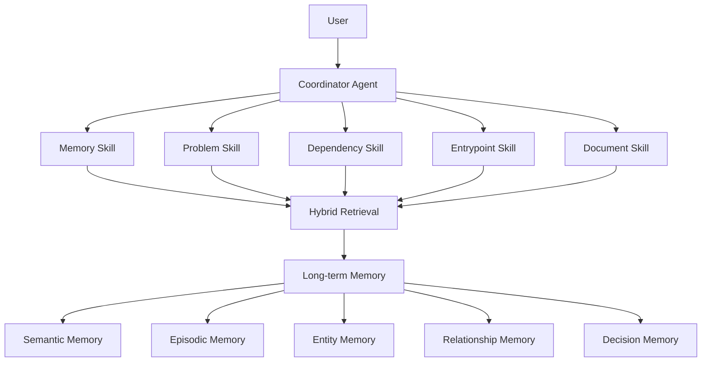

# Collaborative Memory Agent

**基于 Agent + RAG 的研发协作长期记忆系统**

面向研发协作场景，整合聊天记录、Issue、Commit、日志和技术文档等多源过程数据，通过 Agent + RAG 实现历史决策回溯、问题排查复盘、调用链分析和证据化问答。

---

## 项目背景

研发团队的关键上下文往往分散在多个系统中：即时聊天里有方案讨论，Issue 里有问题定位，Commit 里有修复动作，日志里有故障现场，Markdown 文档里有架构沉淀。

这些信息如果缺少统一的长期记忆系统，会带来几个典型问题：

- 信息分散：同一个研发问题可能同时跨越聊天、Issue、Commit、日志和文档。
- 决策难追溯：团队很难快速回答“当时为什么采用这个方案”。
- Bug 修复经验难复用：历史修复过程沉淀不足，类似问题容易重复排查。
- 文档与聊天记录割裂：正式文档记录结论，聊天记录保留过程，两者难以关联。

Collaborative Memory Agent 的目标是构建一个面向研发团队的长期记忆 Agent，让研发过程数据可以被统一检索、关联、总结和追溯。

---

## 系统架构



Coordinator Agent 负责理解问题、计算路由分数并选择对应 Skill。各 Skill 从本地研发过程数据中检索证据，再由 Answer Agent 进行 Evidence → Summary，总结为结构化回答。

---

## 核心能力

### 1. 历史决策回溯

支持追问“为什么采用某个方案”“当时有哪些替代方案”“后续演进计划是什么”。  
系统优先检索 Decision Memory、技术文档和历史讨论，输出决策原因、取舍和证据来源。

### 2. 问题排查复盘

支持从 Issue、日志、Commit 中回溯问题现象、根因、修复方式和影响范围。  
适合复盘历史故障、复用修复经验、快速定位类似问题的处理记录。

### 3. 调用链分析

支持基于本地 Python 代码进行 AST 分析，识别类、函数、方法调用和模块关系。  
可以回答某个 Skill 是如何被调用的、入口在哪里、核心调用路径是什么。

### 4. 文档问答

支持扫描 `docs/` 下的 Markdown 技术文档，并结合关键词检索、BM25 和实体命中进行召回。  
适合查询架构说明、检索方案、长期记忆设计、Prompt 与回答格式约束。

### 5. 长期记忆检索

通过 Semantic、Episodic、Entity、Relationship、Decision 五层记忆组织研发过程知识。  
既能回答模糊自然语言问题，也能围绕实体、决策、Issue、Commit 做精确回溯。

---

## 技术架构

| 技术 | 用途 |
| --- | --- |
| LangGraph | 作为后续可扩展工作流基础，用于表达 Agent 节点、路由和检索流程。 |
| Qwen（SiliconFlow） | 用于 Evidence → Summary，将检索证据总结为简洁中文回答。未配置 API Key 时自动退回本地模板。 |
| BM25 | 用于关键词、中文短文本、Issue 标题和 Commit Message 的词法召回。 |
| Embedding Retrieval | 用于模糊自然语言和语义相似问题的向量召回。 |
| Entity Retrieval | 根据 Agent、Skill、模块、函数、Issue、Commit 和技术关键词提升实体相关证据权重。 |
| BGE-Reranker | 作为重排序设计方向，用于对多路召回结果按相关性重新排序。 |
| FastAPI | 作为后续 API 服务化入口，可将 CLI 能力封装为 HTTP 接口。 |
| Docker | 作为后续部署方式，便于打包运行环境和演示服务。 |

---

## 长期记忆设计

| Memory 类型 | 职责 |
| --- | --- |
| Semantic Memory | 保存沉淀后的项目技术知识，例如架构原则、检索策略和模块职责。 |
| Episodic Memory | 保存历史事件和研发过程片段，例如一次问题排查、一次方案讨论或一次迭代复盘。 |
| Entity Memory | 保存项目实体，例如 CoordinatorAgent、MemorySkill、BM25、Rerank、Decision Memory 等。 |
| Relationship Memory | 保存实体之间的关系，例如 Agent 路由到 Skill、Skill 读取某类数据、检索链路包含某个组件。 |
| Decision Memory | 保存技术决策、替代方案、决策原因、后续计划和证据来源。 |

五层长期记忆共同支撑“从过程数据中回溯研发上下文”的能力，让系统不仅能查文档，也能解释决策、关联实体并复用历史经验。

---

## 示例问题

### 为什么采用混合检索而不是纯向量检索？

示例输出：

```text
【回答】
检索层采用 Exact Match、BM25、Entity Retrieval、Embedding Retrieval 和 Rerank 的混合检索。

采用该方案的原因：
1. 研发问题同时包含精确实体、文件名、函数名、Issue 和模糊自然语言
2. BM25 适合短文本和关键词召回
3. Embedding Retrieval 适合模糊语义查询
4. Rerank 可以综合实体重合度、来源可信度和上下文相关性

相比纯 Embedding Retrieval、单一 BM25、只靠关键词搜索：
更适合研发协作场景中的实体 + 语义混合问题。
```

### 历史上做过哪些技术决策？

示例输出：

```text
【回答】
历史上沉淀的关键技术决策包括：
1. 采用 Coordinator Agent + 多 Skill + RAG 的轻量 MVP 架构
2. 采用 Exact Match、BM25、Entity Retrieval、Embedding Retrieval 和 Rerank 的混合检索
3. 长期记忆采用 Semantic、Episodic、Entity、Relationship 和 Decision Memory 分层
4. Answer Agent 采用先总结再给证据的输出格式
```

### MemorySkill 是怎么被调用的？

示例输出：

```text
【回答】
memory_skill 的调用路径是：
main.py 创建 CoordinatorAgent；
CoordinatorAgent.ask(question) 调用 route(question) 和 route_scores(question)；
随后通过 SkillRegistry.get('memory') 取得 MemorySkill 实例；
最终执行 MemorySkill.run(question) 完成长期记忆检索。
```

### Rerank 相关问题怎么修复？

示例输出：

```text
【回答】
问题现象：检索结果会混入无关聊天或低相关片段。
根因：多路召回后缺少足够明确的重排和证据聚焦。
修复方式：提高 Decision Memory、实体命中和项目文档的权重，并用 Rerank 聚合证据。
涉及文件：src/agents/answer_agent.py、src/skills/memory_skill.py、data/decision_memory.json
```

---

## 快速启动

安装依赖：

```bash
pip install -r requirements.txt
```

配置 SiliconFlow：

```powershell
$env:SILICONFLOW_API_KEY="your_api_key_here"
$env:SILICONFLOW_MODEL="Qwen/Qwen2.5-14B-Instruct"
```

`SILICONFLOW_API_KEY` 未配置时，系统会自动使用本地规则模板生成回答。

运行：

```bash
python main.py
```

输入问题开始检索，输入 `exit` 退出。

---

## 项目亮点

- **Agent + RAG**：通过 Coordinator Agent 统一路由，结合 RAG 检索研发过程证据。
- **多 Skill 协同**：Memory、Problem、Dependency、Entrypoint、Document Skill 分工处理不同问题类型。
- **五层长期记忆体系**：Semantic、Episodic、Entity、Relationship、Decision Memory 共同组织研发上下文。
- **混合检索链路**：Exact Match、BM25、Embedding Retrieval、Entity Retrieval 与 Rerank 覆盖精确实体和模糊语义。
- **Evidence → Summary**：先召回证据，再生成总结，回答保留关键证据、来源文件、关联实体、置信度和路由结果。
